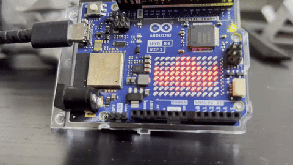

<!--
SPDX-FileCopyrightText: 2026 Juan Medina
SPDX-License-Identifier: MIT
-->

# Arduino UNO R4 WiFi Java Demo

Run modern Java code on an **Arduino UNO R4 WiFi** using ahead-of-time (AOT) compilation with [JUNo](https://github.com/jabrena/juno).

This project compiles Java directly into ARM Cortex-M4 assembly, links it, and flashes it onto the Arduino UNO R4 WiFi board without needing a heavy JVM runtime.

## Demo



*2D Bat symbol rotozoom with animated wing flapping running natively on the 12×8 LED matrix ([MP4 video](video/bat-demo.mp4)).*

## Requirements

- **Java Development Kit (JDK) 27+**
- **Arduino CLI**
- **Git**

## Quick Start

### 1. Clone the repository (including submodules)

```bash
git clone --recursive <repo-url>
cd arduino-uno-test
```

If you already cloned without `--recursive`:
```bash
git submodule update --init --recursive
```

### 2. Run the Setup Script

The setup script verifies Java 27 and Arduino CLI, installs the Renesas core (`arduino:renesas_uno`), and builds the JUno compiler dependencies locally:

**Windows (PowerShell):**
```powershell
.\scripts\setup.ps1
```

**macOS / Linux:**
```bash
chmod +x ./scripts/*.sh ./mvnw
./scripts/setup.sh
```

### 3. Flash to the Board

Plug your Arduino UNO R4 WiFi into your computer via USB-C, then run:

**Windows:**
```powershell
.\mvnw.cmd compile juno:upload
```

Or using the helper script:
```powershell
.\scripts\flash.ps1
```

**macOS / Linux:**
```bash
./mvnw compile juno:upload
```

*Note: If multiple boards are plugged in, pass `-Djuno.port=<PORT>` (e.g. `.\mvnw.cmd compile juno:upload "-Djuno.port=COM11"`).*


## Customizing Your Code

Edit [`src/main/java/com/juanmedina/arduino/App.java`](src/main/java/com/juanmedina/arduino/App.java) to modify the behavior:

- Access the 12x8 LED matrix with `ArduinoUno.getLedMatrix()`
- Control GPIO pins with `ArduinoUno.getGpio()`
- Draw shapes and text onto the matrix with `LedCanvas`

## License

This project is licensed under the [MIT License](LICENSE).
